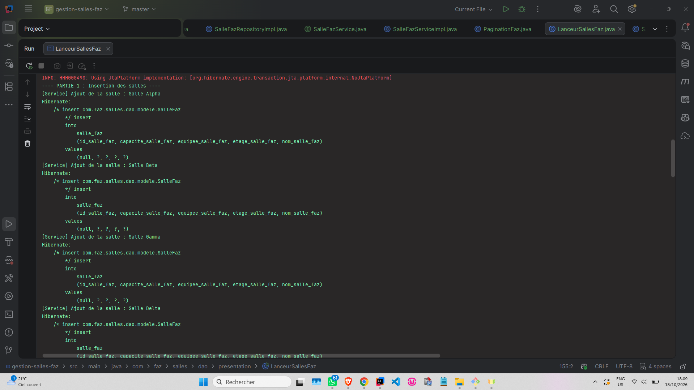
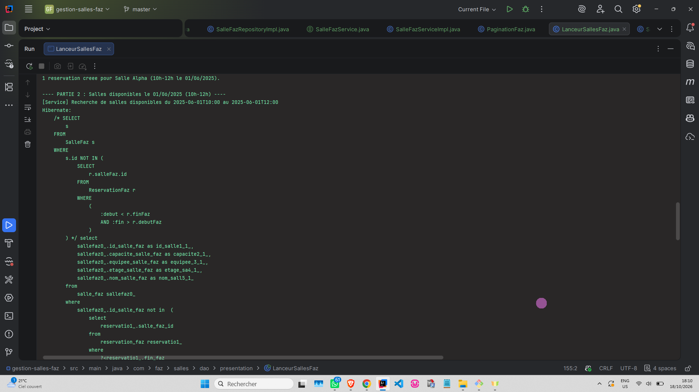
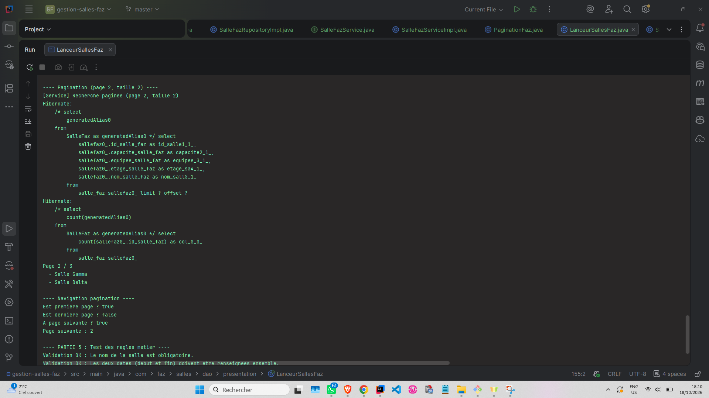
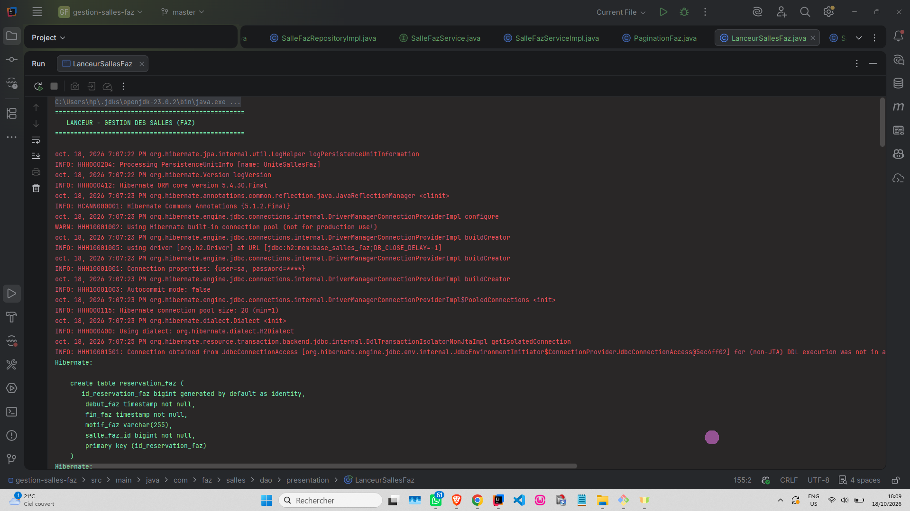
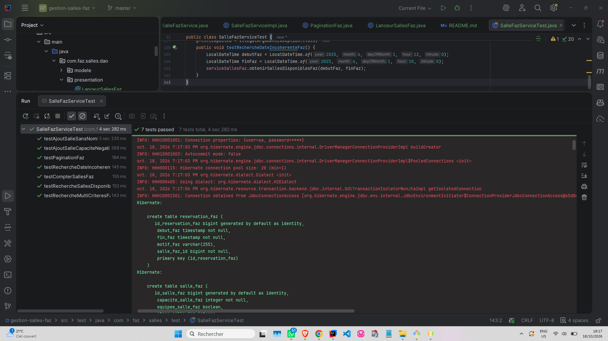

# Gestion des Salles - Projet JPA Complexe (Faz)

Projet Java JPA/Hibernate démontrant l'utilisation de requêtes JPQL, de l'API Criteria pour les recherches dynamiques, et la mise en place d'une pagination côté serveur.

## 📸 Captures d'écran

### 1. Insertion des salles
*Ajout des salles en base de données via le service métier.*

### 2. Salles disponibles
*Résultat de la requête JPQL pour trouver les salles libres sur un créneau donné.*

### 3. Pagination
*Test de la pagination avec la classe `PaginationFaz` (limitation des résultats et calcul du nombre total de pages).*

### 4. Exécution globale
*Logs complets de l'exécution montrant les requêtes SQL générées par Hibernate.*

### 5. Tests unitaires JUnit
*Validation des requêtes JPQL, Criteria, pagination et règles métier avec 7 tests unitaires.*

